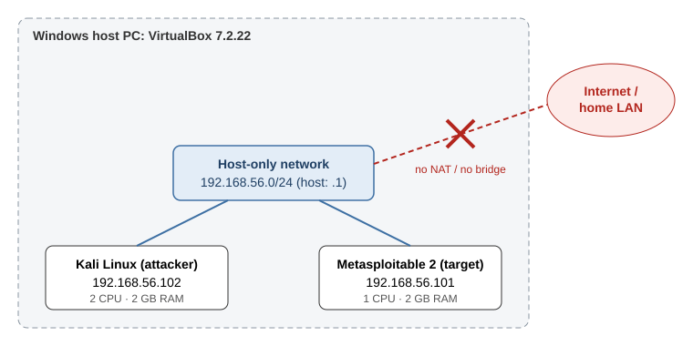
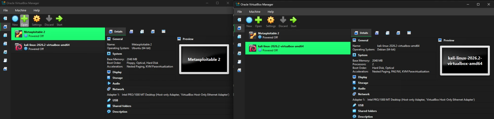
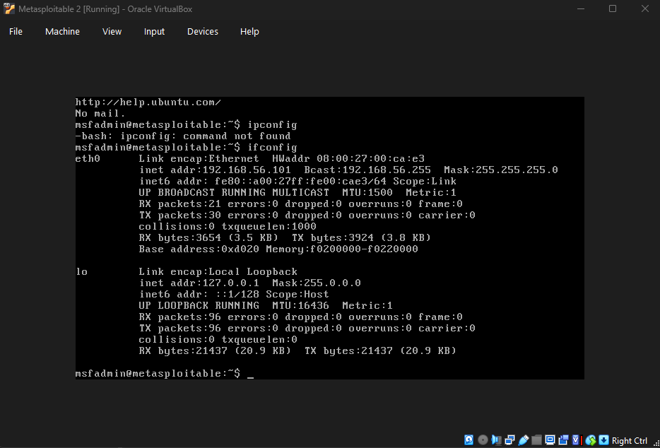
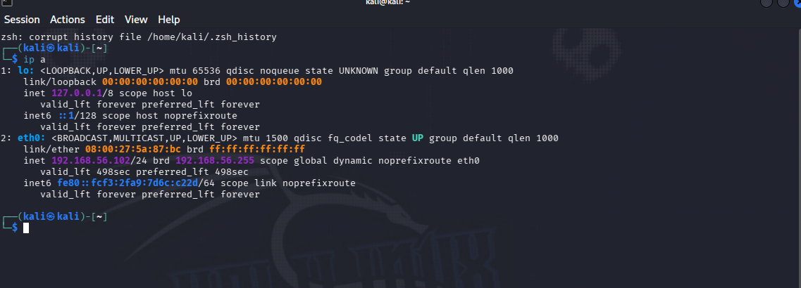
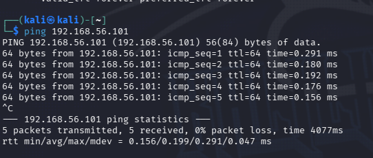
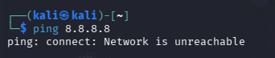

[Back to portfolio]({{ site.baseurl }}/)

## Objective

Build a small, isolated practice lab where I can run security tools legally and safely. The lab needed an attacker machine, a deliberately vulnerable target, and a network that lets the two talk to each other but cannot reach my home network or the internet. Metasploitable 2 is intentionally insecure, so isolation was the main requirement, not an extra.

## Environment and tools

| Item | Details |
| --- | --- |
| Host | Windows 11 PC |
| Hypervisor | Oracle VirtualBox 7.2.22 |
| Attacker VM | Kali Linux 2026.2 (VirtualBox image), 2 CPUs, 2 GB RAM |
| Target VM | Metasploitable 2 (Ubuntu-based), 1 CPU, 2 GB RAM |
| Network | VirtualBox host-only adapter, 192.168.56.0/24, one adapter per VM, no NAT or bridged adapter |
| Tools used | VirtualBox Manager, VBoxManage, `ifconfig`, `ip a`, `ping` |

## Method

1. Installed VirtualBox and imported the Kali Linux VirtualBox image and the Metasploitable 2 virtual disk.
2. On each VM, set **Adapter 1** to *Host-only Adapter* (VirtualBox Host-Only Ethernet Adapter) and left adapters 2 to 8 disabled, so neither VM has a NAT or bridged connection.
3. Confirmed the settings from the command line with `VBoxManage showvminfo` and saved the result as [vm-network-config.txt](evidence/vm-network-config.txt).
4. Booted both VMs and checked their addresses: `ifconfig` on Metasploitable and `ip a` on Kali.
5. Tested that the lab works by pinging the target from Kali.
6. Tested that the lab is isolated by pinging a public address (8.8.8.8) from Kali.

## Results

**Both VMs use only the host-only adapter.** VirtualBox Manager shows Adapter 1 on each machine as *Host-only Adapter* and no other adapters.

**Addresses.** Metasploitable 2 has `192.168.56.101/24` on `eth0`; Kali has `192.168.56.102/24` on `eth0`. Both are on the same host-only subnet, and neither has any other network interface apart from loopback.

**The lab works.** Kali reached the target with 5 packets sent, 5 received, 0% loss and an average round trip of about 0.2 ms. The TTL of 64 shows the target is one hop away, on the same virtual segment.

**The lab is isolated.** `ping 8.8.8.8` failed immediately with `connect: Network is unreachable`. This is a stronger result than a timeout: Kali has no route to anything outside 192.168.56.0/24, so packets are never sent towards the internet at all.

### Troubleshooting log

| Problem | Cause | Fix |
| --- | --- | --- |
| `ipconfig: command not found` on Metasploitable | `ipconfig` is the Windows command | Used the Linux equivalent, `ifconfig` |
| `zsh: corrupt history file` when opening the Kali terminal | The shell history file was damaged, most likely by an unclean VM shutdown | Harmless to the lab; can be cleared by removing `~/.zsh_history`. I now shut Kali down from inside the guest instead of closing the window |

## What I would do differently

- **Use an internal network instead of host-only.** A host-only network still lets the VMs reach the Windows host at 192.168.56.1. That is fine for this lab, but a VirtualBox *Internal Network* would separate the vulnerable target from my host entirely.
- **Assign static IP addresses.** Kali received its address dynamically, so it could change between sessions and break saved commands. Fixed addresses would make the lab more repeatable.
- **Take snapshots.** A clean snapshot of each VM before testing would let me reset the target in seconds after any experiment.
- **Add a monitoring VM.** My next step is a Wazuh SIEM on the same network so I can see the defender's view of my own scans.
